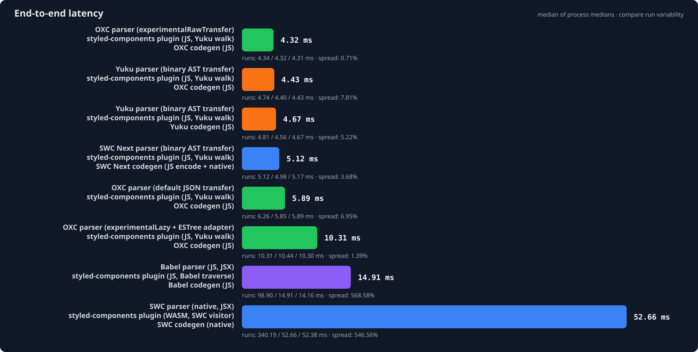
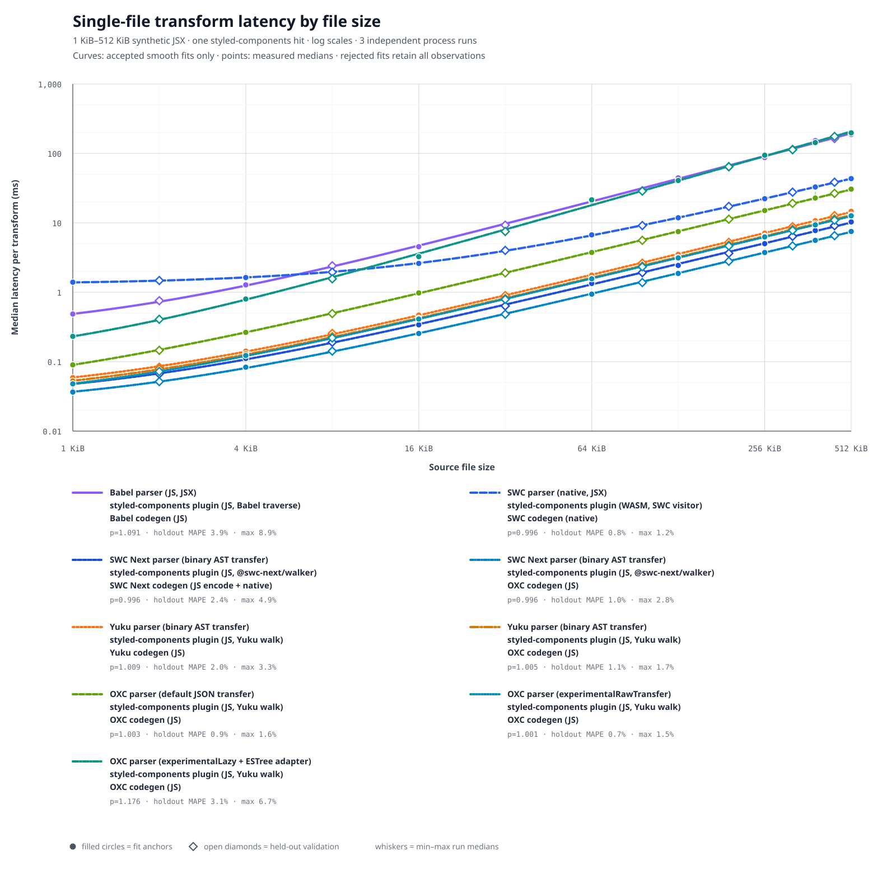
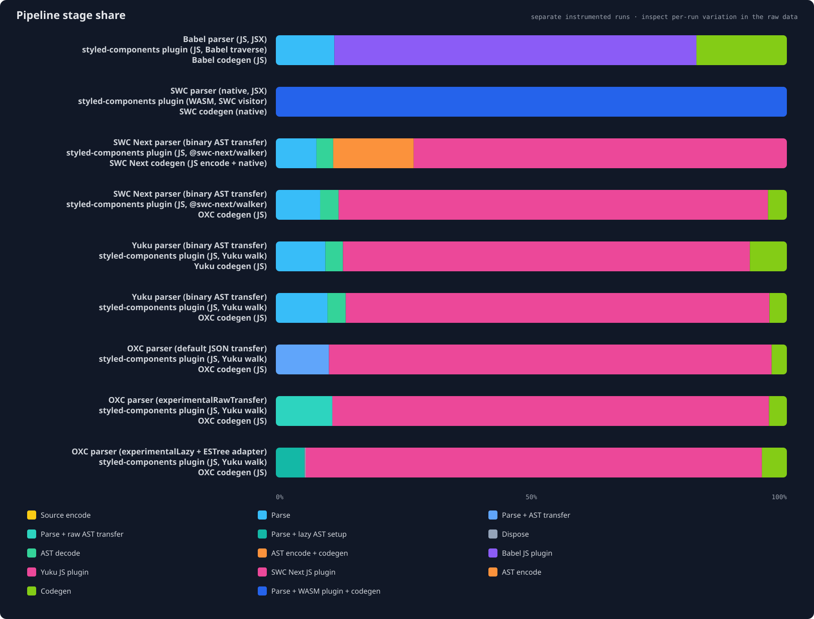
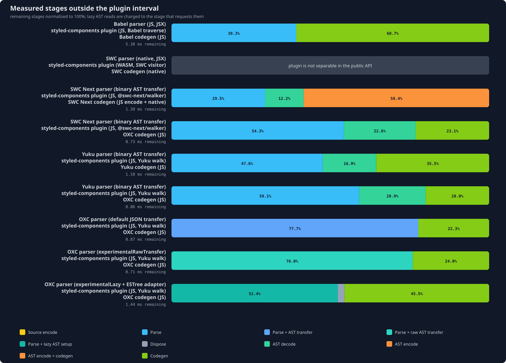

# Transform Plugin Benchmark

Reproducible benchmark of eight styled-components transform pipelines:

- `babel-plugin-styled-components` as a Babel JavaScript plugin
- `@swc/plugin-styled-components` as an SWC WASM plugin
- `@swc-next/core` parse/print with the Yuku JavaScript plugin
- the Babel plugin behavior ported to a Yuku JavaScript plugin
- the same Yuku parser and plugin with `oxc-codegen`
- `oxc-parser` + the Yuku walk plugin + `oxc-codegen`
- the same OXC pipeline with `experimentalRawTransfer`
- OXC `experimentalLazy` with an on-demand mutable ESTree adapter, the Yuku plugin, and OXC codegen

The workload is a pinned real-world multi-file corpus. Every timed iteration starts with the same
87 source files and ends with generated code for all 87 files.

## Pipeline labels

Chart labels show all three stages. The stable short `name` in raw JSON remains an ID;
new measurements and artifact manifests also include structured `pipeline` metadata.
Historical charts resolve codegen runtime from their recorded dependency versions.

| Parser and feature | Styled-components plugin | Codegen |
|---|---|---|
| Babel parser (JS, JSX) | styled-components plugin (JS, Babel traverse) | Babel codegen (JS) |
| SWC parser (native, JSX) | styled-components plugin (WASM, SWC visitor) | SWC codegen (native) |
| SWC Next parser (binary AST transfer) | styled-components plugin (JS, Yuku walk) | SWC Next codegen (JS encode + native) |
| Yuku parser (binary AST transfer) | styled-components plugin (JS, Yuku walk) | Yuku codegen (JS) |
| Yuku parser (binary AST transfer) | styled-components plugin (JS, Yuku walk) | OXC codegen (JS) |
| OXC parser (default JSON transfer) | styled-components plugin (JS, Yuku walk) | OXC codegen (JS) |
| OXC parser (experimentalRawTransfer) | styled-components plugin (JS, Yuku walk) | OXC codegen (JS) |
| OXC parser (experimentalLazy + ESTree adapter) | styled-components plugin (JS, Yuku walk) | OXC codegen (JS) |

## Dependency update

Direct dependencies are pinned to their npm `latest` releases checked on 2026-10-09.
Parser stacks now use Babel 8.0.7, SWC 1.16.13, SWC Next 0.2.4,
OXC 0.153.0, and Yuku 0.18.0. The eight-pipeline results below were rerun with these versions. Linked historical
walker-only reports retain their original versions and timings.

`babel-plugin-styled-components@2.3.0` still declares a Babel 7 peer and calls
three removed JSX builder aliases. A scoped npm override and
[`babel-styled-components-plugin.ts`](scripts/babel-styled-components-plugin.ts)
map those aliases to Babel 8's equivalent builders and preserve the upstream
visitor's temporary identifier for intrinsic hyphenated JSX tags. The full parity suite covers
this compatibility wrapper. Babel parsing, traversal, and printing all use Babel 8.
Yuku 0.18's codegen is now JavaScript, so current profiles use its public `generate`
API and no longer report the removed native encode/codegen stages.

## SWC Next walker comparison

The comparison keeps SWC Next parse/print, corpus, and plugin options unchanged. Each walker
has its own complete styled-components implementation:

- [`yuku-styled-components-plugin.ts`](scripts/yuku-styled-components-plugin.ts) uses Yuku's
  native visitors and mutation context.
- [`zimmerframe-styled-components-plugin.ts`](scripts/zimmerframe-styled-components-plugin.ts)
  uses Zimmerframe's native `path`, `next`, `visit`, and returned replacement nodes. CSS props
  are handled directly on JSX opening elements, without emulating Yuku's `replace`/`remove`.

Both plugins use the same option defaults, AST builders, CSS/hash algorithms, and phase order:
collect imports/bindings, transform styled nodes, collect scopes/names, then transform CSS props.
Their implementations are intentionally separate; behavior changes must update both files and
pass the common parity fixtures. There is no shared runtime plugin or walker compatibility layer.
Tests verify byte-identical output across 87 corpus files and 67 plugin cases, including PURE
comments through Yuku codegen, nested templates, copied scopes, CSS props, and import insertion.
This compares two native plugin implementations end to end; plugin work remains part of the
measurement, so the result is not a standalone walker speed claim.

Historical walker-only measurements on Node 24.18.1 / Apple M5 Max, before the dependency update:

| Pipeline | End-to-end median | Run spread | Plugin stage |
|---|---:|---:|---:|
| SWC Next parser (binary AST transfer) + styled-components plugin (JS, Yuku walk) + SWC Next codegen (JS encode + native) | 5.247 ms | 3.94% | 4.279 ms |
| SWC Next parser (binary AST transfer) + styled-components plugin (JS, Zimmerframe) + SWC Next codegen (JS encode + native) | 5.221 ms | 2.24% | 4.242 ms |

End-to-end values are medians of six process medians. Plugin stages are medians of six
separately measured process means. The approximately 0.5% end-to-end difference is smaller
than either variant's observed run spread and does not establish a stable winner.

See [the native-plugin report](result/swc-next-walkers-native.md) and
[raw measurements](result/swc-next-walkers-native.json). The earlier
[adapter report](result/swc-next-walkers.md) and [data](result/swc-next-walkers.json) are historical
and include compatibility-layer overhead. These walker-only reports retain their original
dependency versions; the eight-pipeline measurements below are refreshed independently.

```bash
fnm use 24.18.1
npm ci
npm run type-check
npm test
npm run bench:walkers
```

This runs only the two SWC Next variants, with six fresh processes per variant, alternating
order, 3 seconds of warmup and 10 seconds of measurement. Stage profiles run separately with
1 second of warmup and 5 seconds of measurement. It writes `result/swc-next-walkers-native.json`, preserving the earlier adapter measurements.

## Result

Node.js 24.18.1 on the machine documented below. Lower latency is better. Every timing covers
all 87 modules, including parsing, the plugin, and code generation.



| Transformer | Median | Independent run medians | Run spread | Relative to Yuku codegen pipeline | Peak RSS |
|-------------|-------:|-------------------------|-----------:|-----------------:|---------:|
| OXC parser (experimentalRawTransfer) + styled-components plugin (JS, Yuku walk) + OXC codegen (JS) | 4.322 ms | 4.344, 4.322, 4.313 ms | 0.71% | 0.93× | 453.1 MiB |
| Yuku parser (binary AST transfer) + styled-components plugin (JS, Yuku walk) + OXC codegen (JS) | 4.432 ms | 4.743, 4.397, 4.432 ms | 7.81% | 0.95× | 458.1 MiB |
| Yuku parser (binary AST transfer) + styled-components plugin (JS, Yuku walk) + Yuku codegen (JS) | 4.667 ms | 4.805, 4.562, 4.667 ms | 5.22% | 1.00× | 460.7 MiB |
| SWC Next parser (binary AST transfer) + styled-components plugin (JS, Yuku walk) + SWC Next codegen (JS encode + native) | 5.121 ms | 5.121, 4.981, 5.169 ms | 3.68% | 1.10× | 634.8 MiB |
| OXC parser (default JSON transfer) + styled-components plugin (JS, Yuku walk) + OXC codegen (JS) | 5.895 ms | 6.262, 5.853, 5.895 ms | 6.95% | 1.26× | 705.0 MiB |
| OXC parser (experimentalLazy + ESTree adapter) + styled-components plugin (JS, Yuku walk) + OXC codegen (JS) | 10.308 ms | 10.308, 10.440, 10.296 ms | 1.39% | 2.21× | 495.2 MiB |
| Babel parser (JS, JSX) + styled-components plugin (JS, Babel traverse) + Babel codegen (JS) | 14.905 ms | 98.905, 14.905, 14.157 ms | 568.58% | 3.19× | 468.0 MiB |
| SWC parser (native, JSX) + styled-components plugin (WASM, SWC visitor) + SWC codegen (native) | 52.659 ms | 340.193, 52.659, 52.384 ms | 546.56% | 11.28× | 189.1 MiB |

The lazy pipeline measured 10.308 ms versus 4.322 ms for raw transfer
(2.39× the latency) on this corpus. This includes the mutable ESTree adapter and
its on-demand source-fragment parsing; it does not isolate the cost of OXC's lazy API or establish
a general limit for lazy AST designs.

Babel and SWC show substantial process-to-process variability: their first run medians were
98.905 ms and 340.193 ms, while their other runs were 14.157–14.905 ms and 52.384–52.659 ms.
All runs are retained. The reported medians and chart ordering describe this measurement;
these rows do not support a stable performance ranking. Smaller differences between the other
pipelines should also be read alongside their recorded run spreads.

Peak RSS is the maximum child-process high-water mark across the three runs. It includes process
startup, loaded dependencies, correctness validation, warmup, and timing, rather than incremental
AST memory. Per-run values are preserved in the raw JSON.

## Single-file scaling

The scaling benchmark measures one complete transform call as an exact-size synthetic JSX module
grows from 1 KiB to 512 KiB. Every file contains exactly one styled-components transform target;
the growing portion has stable ordinary JavaScript AST density. This controls the number of
plugin matches while measuring the full pipeline's response to increasing file size.



Training-set leave-one-out error selects between an offset-power model and a log-quadratic model.
All eight candidates selected `T = a + b × KiB^p`. Seven intermediate sizes are measured but
excluded from fitting. A fit passes only when held-out MAPE is at most 6% and the worst held-out
point error is at most 15%. Seven of eight fits pass; the Yuku-parser/Yuku-codegen candidate is
rejected because its worst error is 15.17%. Its measurements remain visible, but the chart omits
its rejected fitted curve. The thresholds are unchanged.

| Transformer | 1 KiB | 512 KiB | Candidate exponent `p` | Held-out MAPE | Worst held-out error | Fit status |
|-------------|------:|--------:|----------------------:|--------------:|---------------------:|------------|
| Babel parser (JS, JSX) + styled-components plugin (JS, Babel traverse) + Babel codegen (JS) | 0.575 ms | 204.070 ms | 1.052 | 4.56% | 11.81% | accepted |
| SWC parser (native, JSX) + styled-components plugin (WASM, SWC visitor) + SWC codegen (native) | 1.482 ms | 45.822 ms | 1.006 | 0.53% | 1.29% | accepted |
| SWC Next parser (binary AST transfer) + styled-components plugin (JS, Yuku walk) + SWC Next codegen (JS encode + native) | 0.068 ms | 18.608 ms | 1.007 | 2.43% | 6.75% | accepted |
| Yuku parser (binary AST transfer) + styled-components plugin (JS, Yuku walk) + Yuku codegen (JS) | 0.065 ms | 14.793 ms | 0.987 | 4.73% | 15.17% | **rejected** |
| Yuku parser (binary AST transfer) + styled-components plugin (JS, Yuku walk) + OXC codegen (JS) | 0.059 ms | 13.807 ms | 0.997 | 2.53% | 5.83% | accepted |
| OXC parser (default JSON transfer) + styled-components plugin (JS, Yuku walk) + OXC codegen (JS) | 0.092 ms | 31.597 ms | 0.999 | 1.13% | 2.42% | accepted |
| OXC parser (experimentalRawTransfer) + styled-components plugin (JS, Yuku walk) + OXC codegen (JS) | 0.051 ms | 13.333 ms | 1.002 | 1.73% | 2.72% | accepted |
| OXC parser (experimentalLazy + ESTree adapter) + styled-components plugin (JS, Yuku walk) + OXC codegen (JS) | 0.289 ms | 207.570 ms | 1.166 | 4.48% | 8.22% | accepted |

Each point is the median of three independent process-run medians. Each process warms on a
16 KiB module for 200 ms, then measures each of the 15 sizes for at least 200 ms and at least
three complete transforms. The chart uses log scales, shows every measured point, and draws
min–max whiskers for the three run medians.

Passing fit validation describes the aggregated points; it does not imply low run-to-run
variability. For example, Babel's 1 KiB run medians are 5.613, 0.566, and 0.575 ms (878.27% spread).
The lazy pipeline's 512 KiB run medians are 205.836, 288.945, and 207.570 ms (40.04% spread).
The lazy fit exponent of 1.166 describes this adapter and controlled workload over the measured
range; it does not establish asymptotic complexity or an inherent limit of lazy AST access.
No fitted curve is extrapolated past 512 KiB.

All observations, candidate fits, and acceptance flags are retained in
[`result/styled-components-scaling.json`](result/styled-components-scaling.json), including the
rejected fit. The scaling command exits nonzero when any fit is rejected; the JSON is still saved
and can be rendered with `npm run charts`.

## Real-world workload

The corpus is the production JavaScript under `app/` from
[`react-boilerplate` v4.0.0](https://github.com/react-boilerplate/react-boilerplate/tree/d19099afeff64ecfb09133c06c1cb18c0d40887e),
pinned at commit `d19099afeff64ecfb09133c06c1cb18c0d40887e`. Tests are excluded. The source is
vendored under [`benchmark/fixtures/react-boilerplate`](benchmark/fixtures/react-boilerplate) with
its MIT license.

| Corpus property | Value |
|-----------------|------:|
| Production modules | 87 |
| Source size | 57,051 bytes |
| Source lines | 2,313 |
| Modules importing styled-components | 34 |
| Modules containing JSX | 27 |
| Transformed styled components | 32 |

Files are transformed separately in stable path order. They are not concatenated: per-module API,
parse, codegen, filename, displayName, and component ID costs remain part of the workload.

All pipelines receive the same source and options:

```json
{
  "cssProp": true,
  "displayName": true,
  "fileName": true,
  "meaninglessFileNames": ["index"],
  "minify": true,
  "namespace": "",
  "pure": true,
  "ssr": true,
  "topLevelImportPaths": [],
  "transpileTemplateLiterals": true
}
```

The outputs need not be byte-identical. They must provide the same styled-components feature
coverage: all eight pipelines emit 32 `.withConfig` calls, 32 display names, 32 unique component
IDs, preserve 137 JSX elements, and leave no styled tagged templates. Every output is reparsed
before measurement. JSX lowering is outside the measured transform endpoint.

**OXC limitation:** `oxc-codegen` does not print comments; its four rows drop PURE annotations. SWC Next is also configured without comments.

## Inspectable artifacts

The full inputs are the vendored corpus. A representative styled component and all eight generated
forms are committed under [`artifacts/styled-components`](artifacts/styled-components):

- [`input.jsx`](artifacts/styled-components/input.jsx)
- [`babel-output.jsx`](artifacts/styled-components/babel-output.jsx)
- [`swc-output.jsx`](artifacts/styled-components/swc-output.jsx)
- [`swc-next-output.jsx`](artifacts/styled-components/swc-next-output.jsx)
- [`yuku-output.jsx`](artifacts/styled-components/yuku-output.jsx)
- [`yuku-oxc-codegen-output.jsx`](artifacts/styled-components/yuku-oxc-codegen-output.jsx)
- [`oxc-output.jsx`](artifacts/styled-components/oxc-output.jsx)
- [`oxc-raw-transfer-output.jsx`](artifacts/styled-components/oxc-raw-transfer-output.jsx)
- [`oxc-lazy-output.jsx`](artifacts/styled-components/oxc-lazy-output.jsx)
- [`manifest.json`](artifacts/styled-components/manifest.json), containing aggregate corpus/output
  hashes, byte sizes, and validation counts

The Yuku-parser, regular OXC, raw-transfer OXC, and lazy OXC outputs printed by `oxc-codegen` are asserted
byte-for-byte equal across the complete corpus.

## Stage breakdown

Stage profiling is a separate instrumented run over the same corpus. Each reported stage value is
the median of three independent run means. The profile total is the sum of those stage medians;
it is not the end-to-end median above. The range column exposes variability between profile runs.



| Transformer | Stage | Runtime | Median run mean | Run-mean range | Share |
|-------------|-------|---------|----------------:|----------------|------:|
| Babel parser (JS, JSX) + styled-components plugin (JS, Babel traverse) + Babel codegen (JS) | parse | JS | 2.529 ms | 2.316–3.648 ms | 11.7% |
| Babel parser (JS, JSX) + styled-components plugin (JS, Babel traverse) + Babel codegen (JS) | plugin transform | JS | 13.616 ms | 13.575–21.571 ms | 63.1% |
| Babel parser (JS, JSX) + styled-components plugin (JS, Babel traverse) + Babel codegen (JS) | codegen | JS | 5.424 ms | 3.318–268.125 ms | 25.1% |
| SWC parser (native, JSX) + styled-components plugin (WASM, SWC visitor) + SWC codegen (native) | parse + plugin + codegen | native + WASM | 177.702 ms | 105.099–44465.279 ms | 100.0% |
| SWC Next parser (binary AST transfer) + styled-components plugin (JS, Yuku walk) + SWC Next codegen (JS encode + native) | parse | native | 0.397 ms | 0.337–0.411 ms | 7.0% |
| SWC Next parser (binary AST transfer) + styled-components plugin (JS, Yuku walk) + SWC Next codegen (JS encode + native) | AST decode | JS | 0.168 ms | 0.151–0.186 ms | 3.0% |
| SWC Next parser (binary AST transfer) + styled-components plugin (JS, Yuku walk) + SWC Next codegen (JS encode + native) | plugin transform | JS | 4.211 ms | 3.724–4.391 ms | 74.5% |
| SWC Next parser (binary AST transfer) + styled-components plugin (JS, Yuku walk) + SWC Next codegen (JS encode + native) | AST encode + codegen | JS + native | 0.876 ms | 0.812–0.963 ms | 15.5% |
| Yuku parser (binary AST transfer) + styled-components plugin (JS, Yuku walk) + Yuku codegen (JS) | parse | native | 0.563 ms | 0.447–0.585 ms | 10.6% |
| Yuku parser (binary AST transfer) + styled-components plugin (JS, Yuku walk) + Yuku codegen (JS) | AST decode | JS | 0.178 ms | 0.164–0.182 ms | 3.3% |
| Yuku parser (binary AST transfer) + styled-components plugin (JS, Yuku walk) + Yuku codegen (JS) | plugin transform | JS | 4.227 ms | 3.793–4.427 ms | 79.5% |
| Yuku parser (binary AST transfer) + styled-components plugin (JS, Yuku walk) + Yuku codegen (JS) | codegen | JS | 0.348 ms | 0.314–0.368 ms | 6.5% |
| Yuku parser (binary AST transfer) + styled-components plugin (JS, Yuku walk) + OXC codegen (JS) | parse | native | 0.546 ms | 0.440–0.567 ms | 10.7% |
| Yuku parser (binary AST transfer) + styled-components plugin (JS, Yuku walk) + OXC codegen (JS) | AST decode | JS | 0.177 ms | 0.154–0.187 ms | 3.5% |
| Yuku parser (binary AST transfer) + styled-components plugin (JS, Yuku walk) + OXC codegen (JS) | plugin transform | JS | 4.217 ms | 3.800–4.325 ms | 82.5% |
| Yuku parser (binary AST transfer) + styled-components plugin (JS, Yuku walk) + OXC codegen (JS) | codegen | JS | 0.171 ms | 0.151–0.178 ms | 3.4% |
| OXC parser (default JSON transfer) + styled-components plugin (JS, Yuku walk) + OXC codegen (JS) | parse + AST transfer | native + JS | 0.693 ms | 0.657–0.702 ms | 10.6% |
| OXC parser (default JSON transfer) + styled-components plugin (JS, Yuku walk) + OXC codegen (JS) | plugin transform | JS | 5.629 ms | 5.483–6.015 ms | 86.3% |
| OXC parser (default JSON transfer) + styled-components plugin (JS, Yuku walk) + OXC codegen (JS) | codegen | JS | 0.204 ms | 0.198–0.206 ms | 3.1% |
| OXC parser (experimentalRawTransfer) + styled-components plugin (JS, Yuku walk) + OXC codegen (JS) | parse + raw AST transfer | native + JS | 0.565 ms | 0.492–0.572 ms | 11.8% |
| OXC parser (experimentalRawTransfer) + styled-components plugin (JS, Yuku walk) + OXC codegen (JS) | plugin transform | JS | 4.055 ms | 3.884–4.371 ms | 84.7% |
| OXC parser (experimentalRawTransfer) + styled-components plugin (JS, Yuku walk) + OXC codegen (JS) | codegen | JS | 0.171 ms | 0.157–0.175 ms | 3.6% |
| OXC parser (experimentalLazy + ESTree adapter) + styled-components plugin (JS, Yuku walk) + OXC codegen (JS) | parse + lazy AST setup | native + JS | 0.736 ms | 0.688–0.928 ms | 5.4% |
| OXC parser (experimentalLazy + ESTree adapter) + styled-components plugin (JS, Yuku walk) + OXC codegen (JS) | plugin transform | JS (includes lazy ESTree reads) | 12.206 ms | 11.185–14.373 ms | 89.3% |
| OXC parser (experimentalLazy + ESTree adapter) + styled-components plugin (JS, Yuku walk) + OXC codegen (JS) | codegen | JS (includes lazy ESTree reads) | 0.701 ms | 0.631–0.749 ms | 5.1% |
| OXC parser (experimentalLazy + ESTree adapter) + styled-components plugin (JS, Yuku walk) + OXC codegen (JS) | dispose | native + JS | 0.028 ms | 0.025–0.034 ms | 0.2% |

The Babel codegen and combined SWC measurements have especially large outliers, visible in the
ranges and raw run means. Their stage proportions are illustrative and unstable in this run.
These stage medians are not a stable decomposition of the headline latency and should not be
used to infer small performance differences.

SWC exposes its WASM plugin through a complete transform call, so its profile remains combined.
The benchmark does not estimate plugin time by subtraction. Eager OXC parse stages include AST
transfer; the lazy parse stage initializes the handle and root adapter view. Lazy ESTree field
materialization and source-fragment parsing are charged to whichever stage requests them,
including the plugin and printer. The lazy profile also measures handle disposal explicitly.

### Measured stages outside the plugin interval



| Transformer | Sum outside the plugin interval | Remaining measured stages, normalized to 100% |
|-------------|--------------------------------:|-----------------------------------------------|
| Babel parser (JS, JSX) + styled-components plugin (JS, Babel traverse) + Babel codegen (JS) | 7.953 ms | parse 31.8%, codegen 68.2% |
| SWC parser (native, JSX) + styled-components plugin (WASM, SWC visitor) + SWC codegen (native) | not separable | plugin shares the public transform call |
| SWC Next parser (binary AST transfer) + styled-components plugin (JS, Yuku walk) + SWC Next codegen (JS encode + native) | 1.440 ms | parse 27.5%, AST decode 11.7%, AST encode + codegen 60.8% |
| Yuku parser (binary AST transfer) + styled-components plugin (JS, Yuku walk) + Yuku codegen (JS) | 1.089 ms | parse 51.7%, AST decode 16.3%, codegen 32.0% |
| Yuku parser (binary AST transfer) + styled-components plugin (JS, Yuku walk) + OXC codegen (JS) | 0.894 ms | parse 61.1%, AST decode 19.8%, codegen 19.2% |
| OXC parser (default JSON transfer) + styled-components plugin (JS, Yuku walk) + OXC codegen (JS) | 0.897 ms | parse + AST transfer 77.2%, codegen 22.8% |
| OXC parser (experimentalRawTransfer) + styled-components plugin (JS, Yuku walk) + OXC codegen (JS) | 0.735 ms | parse + raw AST transfer 76.8%, codegen 23.2% |
| OXC parser (experimentalLazy + ESTree adapter) + styled-components plugin (JS, Yuku walk) + OXC codegen (JS) | 1.466 ms | parse + lazy AST setup 50.2%, codegen 47.8%, dispose 1.9% |

This view removes the entire measured `plugin transform` interval and renormalizes the remaining
stages. For the lazy pipeline, that also removes any AST materialization and fragment parsing
triggered inside the plugin interval. These are timing boundaries, not a separation of parser
work from plugin work. The view is not a no-op benchmark and cannot establish pure parser or
AST-bridge overhead.

## Correctness coverage

Tests verify all eight pipelines against the complete 87-file corpus, including feature counts,
valid generated JavaScript/JSX, output hashes, and stage-profile/public-transform equality.
The independent Yuku and Zimmerframe styled-components ports also run the upstream plugin
fixtures and additional scope, CSS-prop, import, and mutation cases.

The lazy adapter is checked against the default OXC parser for every AST field and source offset
in the corpus and upstream fixtures, and against the eager pipeline's generated output.
Targeted tests cover lazy initialization, stable identity, field assignment, array mutation,
inserted nodes, directives, rest patterns/parameters, Unicode, literals, contextual expressions,
parser errors, and disposal. Its tests intentionally materialize trees for comparison; timed
adapter initialization does not.

## Experimental lazy pipeline

The new row calls `parseSync({ experimentalLazy: true })`; it does not also enable
`experimentalRawTransfer`, which would take precedence. OXC 0.153.0 exposes read-only native
node shapes here, not mutable ESTree. The local
[`oxc-lazy-estree.ts`](scripts/oxc-lazy-estree.ts) adapter creates one root view initially,
caches node identity, and resolves writable ESTree fields and ordinary child arrays on demand.
The existing styled-components plugin uses Yuku's walker, followed by OXC's JavaScript printer.
It does not use OXC's generated lazy visitor and does not mutate the native AST.

The experimental API omits directives, rest elements, class superclasses, and some literal
information. The adapter recovers these on demand through local source-fragment parsing;
function context is restored when a fragment contains `yield` or `new.target`. All adaptation,
fragment parsing, lazy reads during printing, and native-handle disposal remain inside the
end-to-end measurement. Profiles attribute lazy reads to the stage that requests them.
This is a JavaScript/JSX compatibility experiment for this benchmark, not a general TypeScript
adapter or a measurement of OXC's native lazy visitor in isolation.

The parser handle is disposed in `finally`, including on errors. Optional diagnostic counters
can report wrapped nodes and fragment parsing; those counters are disabled during timing.

## Measurement environment

| Item | Exact value |
|------|-------------|
| Runtime | Node 24.18.1 |
| Package manager | npm 11.16.0 |
| CPU | Apple M5 Max |
| Reported CPU cores | 18 |
| Memory | 64 GiB |
| OS | darwin 25.6.0 (arm64) |
| Babel | `@babel/core@8.0.7`, plugin `2.3.0` |
| SWC | `@swc/core@1.16.13`, WASM plugin `17.0.0` |
| SWC Next | `@swc-next/core@0.2.4` |
| Yuku | parser `0.18.0`, AST `0.18.0`, codegen `0.18.0` (JS) |
| OXC | parser `0.153.0`, codegen `0.153.0` (JS) |
| Zimmerframe | `1.1.5` |

Each transformer runs in a fresh child process for each of three independent runs. A run warms for
1,000 ms and measures for 5,000 ms. Transformer order rotates between runs. The headline value is
the median of the three run medians; “run spread” is `(maximum − minimum) / reported median`.
The median within-run RME remains in the raw JSON but is not a cross-process confidence interval.
Peak RSS uses `process.resourceUsage().maxRSS`, converted to MiB, and takes the maximum over the
three child processes; it measures the whole process lifetime, as described with the result table.

The profile also uses three fresh processes per pipeline, 1,000 ms warmup, and 5,000 ms measurement,
with rotating pipeline order. Its per-stage medians come from these separate runs. The raw data,
including all timing and memory observations, is committed in
[`result/styled-components.json`](result/styled-components.json).

## Reproduce

```bash
fnm install 24.18.1
fnm use 24.18.1
node --version # v24.18.1
npm --version  # 11.16.0

npm ci
npm run reproduce:styled-components
```

The reproduction command rejects another Node version, runs all tests, records three end-to-end
and stage-profile runs, validates the result metadata, and regenerates the artifacts and SVGs.
Single-file scaling is a separate measurement; run it before regenerating the charts to refresh
all four current figures:

```bash
npm run bench:scaling
npm run charts
```

If a scaling fit misses the validation limits, `bench:scaling` exits nonzero after saving the
complete measurements and rejection flags. Run `npm run charts` separately to display those
observations; rejected fitted curves are omitted. The committed scaling run contains one such
rejection, as documented above.

For development:

```bash
npm run type-check
npm test
npm run artifacts
npm run charts
```

Exploratory runs can override `BENCH_TIME`, `BENCH_WARMUP`, `BENCH_RUNS`, `PROFILE_TIME`, or
`PROFILE_WARMUP`. The exact reproduction command always restores the recorded settings.
