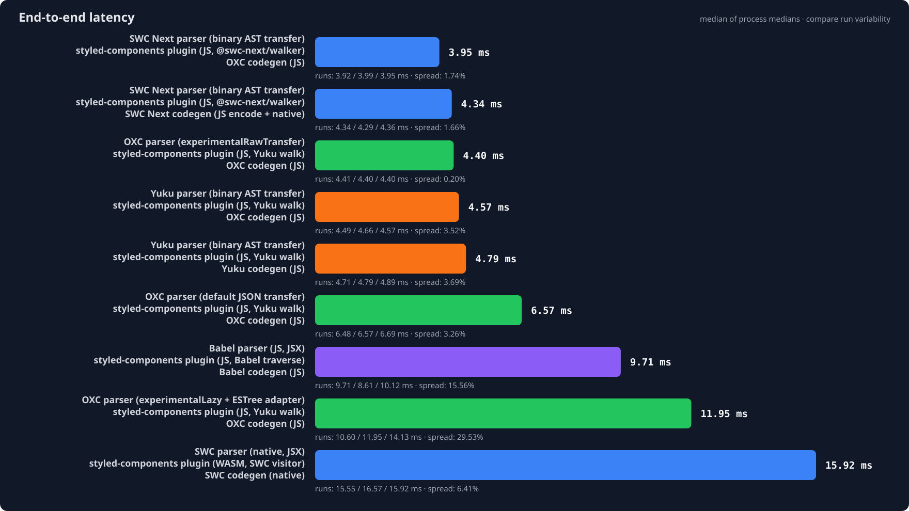
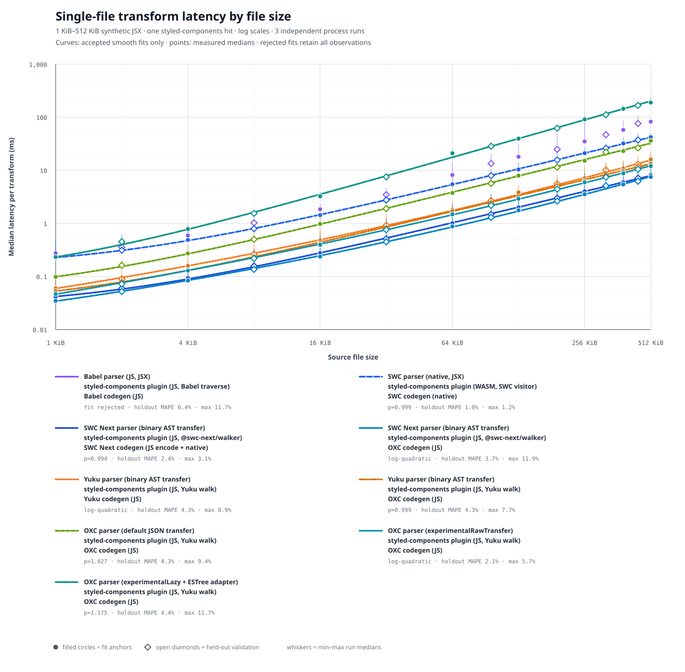
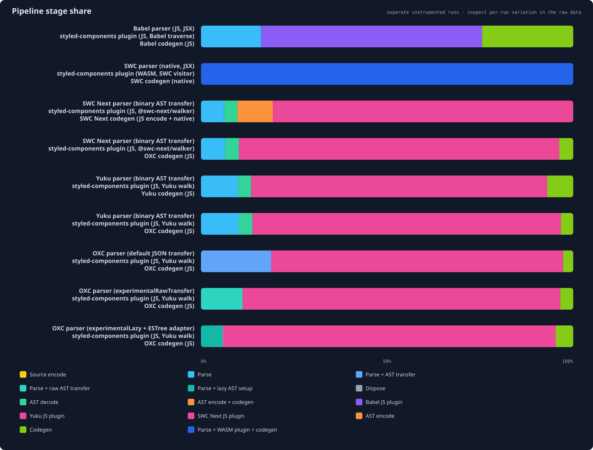
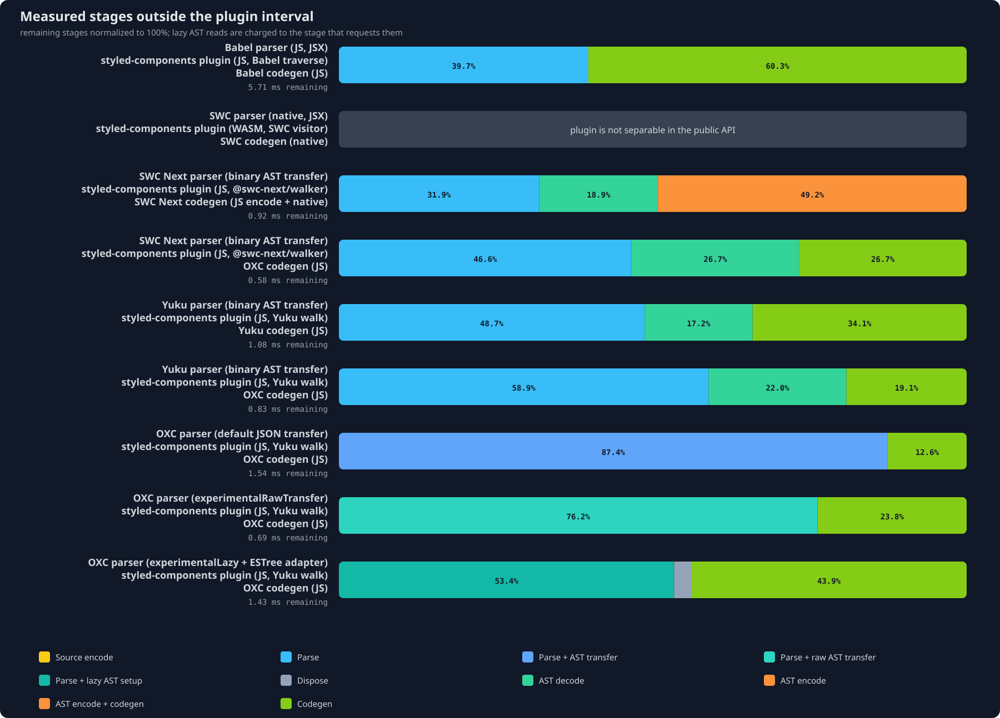

# Transform Plugin Benchmark

Reproducible benchmark of nine styled-components transform pipelines:

- `babel-plugin-styled-components` as a Babel JavaScript plugin
- `@swc/plugin-styled-components` as an SWC WASM plugin
- `@swc-next/core` parse/print with a JavaScript plugin using `@swc-next/walker`
- the same SWC Next parser and walker plugin with `oxc-codegen`
- the Babel plugin behavior ported to a Yuku JavaScript plugin
- the same Yuku parser and plugin with `oxc-codegen`
- `oxc-parser` + the Yuku walk plugin + `oxc-codegen`
- the same OXC pipeline with `experimentalRawTransfer`
- OXC `experimentalLazy` with an on-demand mutable ESTree adapter, the Yuku plugin, and OXC codegen

The workload is a pinned real-world multi-file corpus. Every timed iteration starts with the same
87 source files and ends with generated code for all 87 files.

## Pipeline labels

Chart labels show all three stages. Raw JSON uses a short `name` ID and structured
`pipeline` metadata.

| Parser and feature | Styled-components plugin | Codegen |
|---|---|---|
| Babel parser (JS, JSX) | styled-components plugin (JS, Babel traverse) | Babel codegen (JS) |
| SWC parser (native, JSX) | styled-components plugin (WASM, SWC visitor) | SWC codegen (native) |
| SWC Next parser (binary AST transfer) | styled-components plugin (JS, @swc-next/walker) | SWC Next codegen (JS encode + native) |
| SWC Next parser (binary AST transfer) | styled-components plugin (JS, @swc-next/walker) | OXC codegen (JS) |
| Yuku parser (binary AST transfer) | styled-components plugin (JS, Yuku walk) | Yuku codegen (JS) |
| Yuku parser (binary AST transfer) | styled-components plugin (JS, Yuku walk) | OXC codegen (JS) |
| OXC parser (default JSON transfer) | styled-components plugin (JS, Yuku walk) | OXC codegen (JS) |
| OXC parser (experimentalRawTransfer) | styled-components plugin (JS, Yuku walk) | OXC codegen (JS) |
| OXC parser (experimentalLazy + ESTree adapter) | styled-components plugin (JS, Yuku walk) | OXC codegen (JS) |

## SWC Next walker comparison

The comparison keeps SWC Next parse/print, corpus, and plugin options unchanged. Each walker
has its own complete styled-components implementation:

- [`swc-next-styled-components-plugin.ts`](scripts/swc-next-styled-components-plugin.ts) calls
  `@swc-next/walker` directly, using its native hooks, ancestors, replacement, and removal APIs.
- [`yuku-styled-components-plugin.ts`](scripts/yuku-styled-components-plugin.ts) uses Yuku's
  native visitors and mutation context.
- [`zimmerframe-styled-components-plugin.ts`](scripts/zimmerframe-styled-components-plugin.ts)
  uses Zimmerframe's native `path`, `next`, `visit`, and returned replacement nodes. CSS props
  are handled directly on JSX opening elements, without emulating Yuku's `replace`/`remove`.

All three plugins use the same option defaults, Yuku AST builders and binding helpers,
CSS/hash algorithms, and phase order:
collect imports/bindings, transform styled nodes, collect scopes/names, then transform CSS props.
Their implementations are intentionally separate; behavior changes must update all three files and
pass the common parity fixtures. There is no shared runtime plugin or walker compatibility layer.
Tests verify byte-identical output across 87 corpus files and 67 plugin cases, including PURE
comments through Yuku codegen, nested templates, copied scopes, CSS props, and import insertion.
This compares native plugin implementations end to end; plugin work remains part of the
measurement, so the result is not a standalone walker speed claim.

| Pipeline | End-to-end median | Run spread | Plugin stage |
|---|---:|---:|---:|
| SWC Next parser (binary AST transfer) + styled-components plugin (JS, @swc-next/walker) + SWC Next codegen (JS encode + native) | 4.359 ms | 10.03% | 3.626 ms |
| SWC Next parser (binary AST transfer) + styled-components plugin (JS, Yuku walk) + SWC Next codegen (JS encode + native) | 4.575 ms | 3.14% | 3.900 ms |
| SWC Next parser (binary AST transfer) + styled-components plugin (JS, Zimmerframe) + SWC Next codegen (JS encode + native) | 4.619 ms | 11.21% | 3.888 ms |

End-to-end values are medians of six process medians. Plugin stages are medians of six
separately measured process means. Compare the observed run spreads before interpreting small differences.

See [the raw measurements](result/swc-next-walkers-current.json).

```bash
fnm use 24.18.1
npm ci
npm run type-check
npm test
npm run bench:walkers
```

This runs the three SWC Next variants, with six fresh processes per variant and rotating
order, 3 seconds of warmup and 10 seconds of measurement. Stage profiles run separately with
1 second of warmup and 5 seconds of measurement. It writes `result/swc-next-walkers-current.json`.
The separate `node --import tsx scripts/bench-walker-traversal.mjs` command counts identifiers
on pre-parsed trees with all three walkers, records installed versions, and writes
[`result/swc-next-walkers-traversal-current.json`](result/swc-next-walkers-traversal-current.json).
The read-only run visits the same 1,916 identifiers with every walker and uses six fresh processes per
walker, 1 second of warmup and 2 seconds of measurement, with rotating order:

| Walker | Read-only median | Run spread |
|--------|-----------------:|-----------:|
| swc-next | 0.078 ms | 8.06% |
| yuku | 0.199 ms | 4.89% |
| zimmerframe | 0.175 ms | 3.28% |

## Result

Node.js 24.18.1 on the machine documented below. Lower latency is better. Every timing covers
all 87 modules, including parsing, the plugin, and code generation.



| Transformer | Median | Independent run medians | Run spread | Relative to Yuku codegen pipeline | Peak RSS |
|-------------|-------:|-------------------------|-----------:|-----------------:|---------:|
| SWC Next parser (binary AST transfer) + styled-components plugin (JS, @swc-next/walker) + OXC codegen (JS) | 3.949 ms | 3.925, 3.993, 3.949 ms | 1.74% | 0.82× | 463.0 MiB |
| SWC Next parser (binary AST transfer) + styled-components plugin (JS, @swc-next/walker) + SWC Next codegen (JS encode + native) | 4.343 ms | 4.343, 4.289, 4.361 ms | 1.66% | 0.91× | 463.6 MiB |
| OXC parser (experimentalRawTransfer) + styled-components plugin (JS, Yuku walk) + OXC codegen (JS) | 4.404 ms | 4.407, 4.398, 4.404 ms | 0.20% | 0.92× | 452.1 MiB |
| Yuku parser (binary AST transfer) + styled-components plugin (JS, Yuku walk) + OXC codegen (JS) | 4.572 ms | 4.494, 4.655, 4.572 ms | 3.52% | 0.95× | 468.6 MiB |
| Yuku parser (binary AST transfer) + styled-components plugin (JS, Yuku walk) + Yuku codegen (JS) | 4.794 ms | 4.708, 4.794, 4.886 ms | 3.69% | 1.00× | 470.6 MiB |
| OXC parser (default JSON transfer) + styled-components plugin (JS, Yuku walk) + OXC codegen (JS) | 6.566 ms | 6.481, 6.566, 6.695 ms | 3.26% | 1.37× | 467.5 MiB |
| Babel parser (JS, JSX) + styled-components plugin (JS, Babel traverse) + Babel codegen (JS) | 9.712 ms | 9.712, 8.611, 10.122 ms | 15.56% | 2.03× | 774.2 MiB |
| OXC parser (experimentalLazy + ESTree adapter) + styled-components plugin (JS, Yuku walk) + OXC codegen (JS) | 11.952 ms | 10.597, 11.952, 14.126 ms | 29.53% | 2.49× | 499.1 MiB |
| SWC parser (native, JSX) + styled-components plugin (WASM, SWC visitor) + SWC codegen (native) | 15.915 ms | 15.548, 16.568, 15.915 ms | 6.41% | 3.32× | 210.4 MiB |

The lazy pipeline measured 11.952 ms versus 4.404 ms for raw transfer
(2.71× the latency) on this corpus. This includes the mutable ESTree adapter and
its on-demand source-fragment parsing; it does not isolate the cost of OXC's lazy API or establish
a general limit for lazy AST designs.

All independent runs are retained. Read the reported medians alongside their run spreads;
small differences do not establish a stable performance ranking.

Peak RSS is the maximum child-process high-water mark across the three runs. It includes process
startup, loaded dependencies, correctness validation, warmup, and timing, rather than incremental
AST memory. Per-run values are preserved in the raw JSON.

## Single-file scaling

The scaling benchmark measures one complete transform call as an exact-size synthetic JSX module
grows from 1 KiB to 512 KiB. Every file contains exactly one styled-components transform target;
the growing portion has stable ordinary JavaScript AST density. This controls the number of
plugin matches while measuring the full pipeline's response to increasing file size.



Training-set leave-one-out error selects between an offset-power model and a log-quadratic model.
Offset-power rows report `p` in `T = a + b × KiB^p`; log-quadratic rows fit `ln(T) = a + b × ln(KiB) + c × ln(KiB)^2`. Seven intermediate sizes are measured but
excluded from fitting. A fit passes only when held-out MAPE is at most 6% and the worst held-out
point error is at most 15%. Eight of nine fits pass; Babel's held-out MAPE is 6.36%, so its fit is
rejected. All measurements are retained while the chart omits the rejected fitted curve.

| Transformer | 1 KiB | 512 KiB | Model / exponent `p` | Held-out MAPE | Worst held-out error | Fit status |
|-------------|------:|--------:|----------------------:|--------------:|---------------------:|------------|
| Babel parser (JS, JSX) + styled-components plugin (JS, Babel traverse) + Babel codegen (JS) | 0.274 ms | 82.764 ms | 1.108 | 6.36% | 11.67% | rejected |
| SWC parser (native, JSX) + styled-components plugin (WASM, SWC visitor) + SWC codegen (native) | 0.226 ms | 42.296 ms | 0.999 | 0.95% | 1.22% | accepted |
| SWC Next parser (binary AST transfer) + styled-components plugin (JS, @swc-next/walker) + SWC Next codegen (JS encode + native) | 0.041 ms | 8.124 ms | 0.994 | 2.42% | 3.12% | accepted |
| SWC Next parser (binary AST transfer) + styled-components plugin (JS, @swc-next/walker) + OXC codegen (JS) | 0.035 ms | 7.515 ms | log-quadratic | 3.72% | 11.92% | accepted |
| Yuku parser (binary AST transfer) + styled-components plugin (JS, Yuku walk) + Yuku codegen (JS) | 0.060 ms | 16.033 ms | log-quadratic | 4.31% | 8.90% | accepted |
| Yuku parser (binary AST transfer) + styled-components plugin (JS, Yuku walk) + OXC codegen (JS) | 0.053 ms | 13.306 ms | 0.999 | 4.33% | 7.66% | accepted |
| OXC parser (default JSON transfer) + styled-components plugin (JS, Yuku walk) + OXC codegen (JS) | 0.098 ms | 36.027 ms | 1.027 | 4.29% | 9.39% | accepted |
| OXC parser (experimentalRawTransfer) + styled-components plugin (JS, Yuku walk) + OXC codegen (JS) | 0.047 ms | 12.061 ms | log-quadratic | 2.13% | 5.67% | accepted |
| OXC parser (experimentalLazy + ESTree adapter) + styled-components plugin (JS, Yuku walk) + OXC codegen (JS) | 0.233 ms | 189.942 ms | 1.175 | 4.41% | 11.75% | accepted |

Each point is the median of three independent process-run medians. Each process warms on a
16 KiB module for 200 ms, then measures each of the 15 sizes for at least 200 ms and at least
three complete transforms. The chart uses log scales, shows every measured point, and draws
min–max whiskers for the three run medians.

Passing fit validation describes the aggregated points; it does not imply low run-to-run
variability. Independent run medians and spreads are retained for every point. Fitted exponents
describe this controlled workload over the measured range; they do not establish asymptotic
complexity or an inherent limit of lazy AST access. No curve is extrapolated past 512 KiB.

All observations, candidate fits, and acceptance flags are retained in
[`result/styled-components-scaling.json`](result/styled-components-scaling.json). The scaling
command exits nonzero when any fit is rejected; the JSON is still saved and can be rendered
with `npm run charts`.

## Real-world workload

The corpus is the production JavaScript under `app/` from
[`react-boilerplate` v4.0.0](https://github.com/react-boilerplate/react-boilerplate/tree/d19099afeff64ecfb09133c06c1cb18c0d40887e),
pinned at commit `d19099afeff64ecfb09133c06c1cb18c0d40887e`. Tests are excluded. The source is
vendored under [`benchmark/fixtures/react-boilerplate`](benchmark/fixtures/react-boilerplate) with
its MIT license.

| Corpus property | Value |
|-----------------|------:|
| Production modules | 87 |
| Source size | 57,051 bytes |
| Source lines | 2,313 |
| Modules importing styled-components | 34 |
| Modules containing JSX | 27 |
| Transformed styled components | 32 |

Files are transformed separately in stable path order. They are not concatenated: per-module API,
parse, codegen, filename, displayName, and component ID costs remain part of the workload.

All pipelines receive the same source and options:

```json
{
  "cssProp": true,
  "displayName": true,
  "fileName": true,
  "meaninglessFileNames": ["index"],
  "minify": true,
  "namespace": "",
  "pure": true,
  "ssr": true,
  "topLevelImportPaths": [],
  "transpileTemplateLiterals": true
}
```

The outputs need not be byte-identical. They must provide the same styled-components feature
coverage: all nine pipelines emit 32 `.withConfig` calls, 32 display names, 32 unique component
IDs, preserve 137 JSX elements, and leave no styled tagged templates. Every output is reparsed
before measurement. JSX lowering is outside the measured transform endpoint.

**OXC limitation:** `oxc-codegen` does not print comments; its five rows drop PURE annotations. Both SWC Next cases also parse without comments.

## Inspectable artifacts

The full inputs are the vendored corpus. A representative styled component and all nine generated
forms are committed under [`artifacts/styled-components`](artifacts/styled-components):

- [`input.jsx`](artifacts/styled-components/input.jsx)
- [`babel-output.jsx`](artifacts/styled-components/babel-output.jsx)
- [`swc-output.jsx`](artifacts/styled-components/swc-output.jsx)
- [`swc-next-output.jsx`](artifacts/styled-components/swc-next-output.jsx)
- [`swc-next-oxc-codegen-output.jsx`](artifacts/styled-components/swc-next-oxc-codegen-output.jsx)
- [`yuku-output.jsx`](artifacts/styled-components/yuku-output.jsx)
- [`yuku-oxc-codegen-output.jsx`](artifacts/styled-components/yuku-oxc-codegen-output.jsx)
- [`oxc-output.jsx`](artifacts/styled-components/oxc-output.jsx)
- [`oxc-raw-transfer-output.jsx`](artifacts/styled-components/oxc-raw-transfer-output.jsx)
- [`oxc-lazy-output.jsx`](artifacts/styled-components/oxc-lazy-output.jsx)
- [`manifest.json`](artifacts/styled-components/manifest.json), containing aggregate corpus/output
  hashes, byte sizes, and validation counts

The SWC Next, Yuku-parser, regular OXC, raw-transfer OXC, and lazy OXC outputs printed by `oxc-codegen` are asserted
byte-for-byte equal across the complete corpus.

## Stage breakdown

Stage profiling is a separate instrumented run over the same corpus. Each reported stage value is
the median of three independent run means. The profile total is the sum of those stage medians;
it is not the end-to-end median above. The range column exposes variability between profile runs.



| Transformer | Stage | Runtime | Median run mean | Run-mean range | Share |
|-------------|-------|---------|----------------:|----------------|------:|
| Babel parser (JS, JSX) + styled-components plugin (JS, Babel traverse) + Babel codegen (JS) | parse | JS | 2.270 ms | 2.138–2.463 ms | 16.1% |
| Babel parser (JS, JSX) + styled-components plugin (JS, Babel traverse) + Babel codegen (JS) | plugin transform | JS | 8.351 ms | 8.151–8.662 ms | 59.4% |
| Babel parser (JS, JSX) + styled-components plugin (JS, Babel traverse) + Babel codegen (JS) | codegen | JS | 3.444 ms | 3.384–3.515 ms | 24.5% |
| SWC parser (native, JSX) + styled-components plugin (WASM, SWC visitor) + SWC codegen (native) | parse + plugin + codegen | native + WASM | 15.657 ms | 15.639–18.191 ms | 100.0% |
| SWC Next parser (binary AST transfer) + styled-components plugin (JS, @swc-next/walker) + SWC Next codegen (JS encode + native) | parse | native | 0.295 ms | 0.270–0.311 ms | 6.2% |
| SWC Next parser (binary AST transfer) + styled-components plugin (JS, @swc-next/walker) + SWC Next codegen (JS encode + native) | AST decode | JS | 0.175 ms | 0.162–0.176 ms | 3.6% |
| SWC Next parser (binary AST transfer) + styled-components plugin (JS, @swc-next/walker) + SWC Next codegen (JS encode + native) | plugin transform | JS | 3.860 ms | 3.657–3.991 ms | 80.7% |
| SWC Next parser (binary AST transfer) + styled-components plugin (JS, @swc-next/walker) + SWC Next codegen (JS encode + native) | AST encode + codegen | JS + native | 0.454 ms | 0.423–0.480 ms | 9.5% |
| SWC Next parser (binary AST transfer) + styled-components plugin (JS, @swc-next/walker) + OXC codegen (JS) | parse | native | 0.272 ms | 0.265–0.310 ms | 6.5% |
| SWC Next parser (binary AST transfer) + styled-components plugin (JS, @swc-next/walker) + OXC codegen (JS) | AST decode | JS | 0.156 ms | 0.148–0.169 ms | 3.7% |
| SWC Next parser (binary AST transfer) + styled-components plugin (JS, @swc-next/walker) + OXC codegen (JS) | plugin transform | JS | 3.615 ms | 3.543–3.906 ms | 86.1% |
| SWC Next parser (binary AST transfer) + styled-components plugin (JS, @swc-next/walker) + OXC codegen (JS) | codegen | JS | 0.156 ms | 0.154–0.178 ms | 3.7% |
| Yuku parser (binary AST transfer) + styled-components plugin (JS, Yuku walk) + Yuku codegen (JS) | parse | native | 0.528 ms | 0.457–0.599 ms | 10.0% |
| Yuku parser (binary AST transfer) + styled-components plugin (JS, Yuku walk) + Yuku codegen (JS) | AST decode | JS | 0.187 ms | 0.165–0.189 ms | 3.5% |
| Yuku parser (binary AST transfer) + styled-components plugin (JS, Yuku walk) + Yuku codegen (JS) | plugin transform | JS | 4.208 ms | 3.904–4.250 ms | 79.5% |
| Yuku parser (binary AST transfer) + styled-components plugin (JS, Yuku walk) + Yuku codegen (JS) | codegen | JS | 0.370 ms | 0.327–0.384 ms | 7.0% |
| Yuku parser (binary AST transfer) + styled-components plugin (JS, Yuku walk) + OXC codegen (JS) | parse | native | 0.489 ms | 0.465–0.516 ms | 10.1% |
| Yuku parser (binary AST transfer) + styled-components plugin (JS, Yuku walk) + OXC codegen (JS) | AST decode | JS | 0.182 ms | 0.173–0.186 ms | 3.8% |
| Yuku parser (binary AST transfer) + styled-components plugin (JS, Yuku walk) + OXC codegen (JS) | plugin transform | JS | 4.017 ms | 3.945–4.101 ms | 82.9% |
| Yuku parser (binary AST transfer) + styled-components plugin (JS, Yuku walk) + OXC codegen (JS) | codegen | JS | 0.159 ms | 0.151–0.179 ms | 3.3% |
| OXC parser (default JSON transfer) + styled-components plugin (JS, Yuku walk) + OXC codegen (JS) | parse + AST transfer | native + JS | 1.346 ms | 1.272–1.372 ms | 18.8% |
| OXC parser (default JSON transfer) + styled-components plugin (JS, Yuku walk) + OXC codegen (JS) | plugin transform | JS | 5.605 ms | 5.431–5.769 ms | 78.4% |
| OXC parser (default JSON transfer) + styled-components plugin (JS, Yuku walk) + OXC codegen (JS) | codegen | JS | 0.194 ms | 0.185–0.213 ms | 2.7% |
| OXC parser (experimentalRawTransfer) + styled-components plugin (JS, Yuku walk) + OXC codegen (JS) | parse + raw AST transfer | native + JS | 0.526 ms | 0.516–0.627 ms | 11.2% |
| OXC parser (experimentalRawTransfer) + styled-components plugin (JS, Yuku walk) + OXC codegen (JS) | plugin transform | JS | 4.023 ms | 3.972–4.371 ms | 85.4% |
| OXC parser (experimentalRawTransfer) + styled-components plugin (JS, Yuku walk) + OXC codegen (JS) | codegen | JS | 0.164 ms | 0.157–0.204 ms | 3.5% |
| OXC parser (experimentalLazy + ESTree adapter) + styled-components plugin (JS, Yuku walk) + OXC codegen (JS) | parse + lazy AST setup | native + JS | 0.766 ms | 0.760–0.849 ms | 5.7% |
| OXC parser (experimentalLazy + ESTree adapter) + styled-components plugin (JS, Yuku walk) + OXC codegen (JS) | plugin transform | JS (includes lazy ESTree reads) | 11.990 ms | 11.367–13.494 ms | 89.3% |
| OXC parser (experimentalLazy + ESTree adapter) + styled-components plugin (JS, Yuku walk) + OXC codegen (JS) | codegen | JS (includes lazy ESTree reads) | 0.630 ms | 0.555–0.691 ms | 4.7% |
| OXC parser (experimentalLazy + ESTree adapter) + styled-components plugin (JS, Yuku walk) + OXC codegen (JS) | dispose | native + JS | 0.039 ms | 0.029–0.040 ms | 0.3% |

Per-stage ranges expose variation across the independent profile runs. These stage medians
are not a stable decomposition of the headline latency and should not be used to infer
small performance differences.

SWC exposes its WASM plugin through a complete transform call, so its profile remains combined.
The benchmark does not estimate plugin time by subtraction. Eager OXC parse stages include AST
transfer; the lazy parse stage initializes the handle and root adapter view. Lazy ESTree field
materialization and source-fragment parsing are charged to whichever stage requests them,
including the plugin and printer. The lazy profile also measures handle disposal explicitly.

### Measured stages outside the plugin interval



| Transformer | Sum outside the plugin interval | Remaining measured stages, normalized to 100% |
|-------------|--------------------------------:|-----------------------------------------------|
| Babel parser (JS, JSX) + styled-components plugin (JS, Babel traverse) + Babel codegen (JS) | 5.713 ms | parse 39.7%, codegen 60.3% |
| SWC parser (native, JSX) + styled-components plugin (WASM, SWC visitor) + SWC codegen (native) | not separable | plugin shares the public transform call |
| SWC Next parser (binary AST transfer) + styled-components plugin (JS, @swc-next/walker) + SWC Next codegen (JS encode + native) | 0.923 ms | parse 31.9%, AST decode 18.9%, AST encode + codegen 49.2% |
| SWC Next parser (binary AST transfer) + styled-components plugin (JS, @swc-next/walker) + OXC codegen (JS) | 0.584 ms | parse 46.6%, AST decode 26.7%, codegen 26.7% |
| Yuku parser (binary AST transfer) + styled-components plugin (JS, Yuku walk) + Yuku codegen (JS) | 1.084 ms | parse 48.7%, AST decode 17.2%, codegen 34.1% |
| Yuku parser (binary AST transfer) + styled-components plugin (JS, Yuku walk) + OXC codegen (JS) | 0.830 ms | parse 58.9%, AST decode 22.0%, codegen 19.1% |
| OXC parser (default JSON transfer) + styled-components plugin (JS, Yuku walk) + OXC codegen (JS) | 1.540 ms | parse + AST transfer 87.4%, codegen 12.6% |
| OXC parser (experimentalRawTransfer) + styled-components plugin (JS, Yuku walk) + OXC codegen (JS) | 0.690 ms | parse + raw AST transfer 76.2%, codegen 23.8% |
| OXC parser (experimentalLazy + ESTree adapter) + styled-components plugin (JS, Yuku walk) + OXC codegen (JS) | 1.435 ms | parse + lazy AST setup 53.4%, codegen 43.9%, dispose 2.7% |

This view removes the entire measured `plugin transform` interval and renormalizes the remaining
stages. For the lazy pipeline, that also removes any AST materialization and fragment parsing
triggered inside the plugin interval. These are timing boundaries, not a separation of parser
work from plugin work. The view is not a no-op benchmark and cannot establish pure parser or
AST-bridge overhead.

## Correctness coverage

Tests verify all nine pipelines against the complete 87-file corpus, including feature counts,
valid generated JavaScript/JSX, output hashes, and stage-profile/public-transform equality.
The independent SWC Next, Yuku, and Zimmerframe styled-components ports also run the upstream plugin
fixtures and additional scope, CSS-prop, import, and mutation cases.

The lazy adapter is checked against the default OXC parser for every AST field and source offset
in the corpus and upstream fixtures, and against the eager pipeline's generated output.
Targeted tests cover lazy initialization, stable identity, field assignment, array mutation,
inserted nodes, directives, rest patterns/parameters, Unicode, literals, contextual expressions,
parser errors, and disposal. Its tests intentionally materialize trees for comparison; timed
adapter initialization does not.

## Experimental lazy pipeline

The lazy pipeline calls `parseSync({ experimentalLazy: true })`; it does not also enable
`experimentalRawTransfer`, which would take precedence. OXC 0.159.0 exposes read-only native
node shapes here, not mutable ESTree. The local
[`oxc-lazy-estree.ts`](scripts/oxc-lazy-estree.ts) adapter creates one root view initially,
caches node identity, and resolves writable ESTree fields and ordinary child arrays on demand.
The existing styled-components plugin uses Yuku's walker, followed by OXC's JavaScript printer.
It does not use OXC's generated lazy visitor and does not mutate the native AST.

The experimental API omits directives, rest elements, class superclasses, and some literal
information. The adapter recovers these on demand through local source-fragment parsing;
function context is restored when a fragment contains `yield` or `new.target`. All adaptation,
fragment parsing, lazy reads during printing, and native-handle disposal remain inside the
end-to-end measurement. Profiles attribute lazy reads to the stage that requests them.
This is a JavaScript/JSX compatibility experiment for this benchmark, not a general TypeScript
adapter or a measurement of OXC's native lazy visitor in isolation.

The parser handle is disposed in `finally`, including on errors. Optional diagnostic counters
can report wrapped nodes and fragment parsing; those counters are disabled during timing.

## Measurement environment

| Item | Exact value |
|------|-------------|
| Measurement date | 2026-11-17 |
| Runtime | Node 24.18.1 |
| Package manager | npm 11.16.0 |
| CPU | Apple M5 Max |
| Reported CPU cores | 18 |
| Memory | 64 GiB |
| OS | darwin 25.6.0 (arm64) |
| Babel | `@babel/core@8.1.2`, plugin `2.4.0` |
| SWC | `@swc/core@1.16.22`, WASM plugin `18.0.3` |
| SWC Next | `@swc-next/core@0.7.0`, `@swc-next/walker@0.7.0` |
| Yuku | parser `0.19.0`, AST `0.19.0`, codegen `0.19.0` (JS) |
| OXC | parser `0.159.0`, codegen `0.159.0` (JS) |
| Zimmerframe | `1.1.5` |

All performance suites were run serially on this machine with the same runtime and lockfile.
Normal desktop applications remained running; no other user processes were stopped.

Each transformer runs in a fresh child process for each of three independent runs. A run warms for
1,000 ms and measures for 5,000 ms. Transformer order rotates between runs. The headline value is
the median of the three run medians; “run spread” is `(maximum − minimum) / reported median`.
The median within-run RME remains in the raw JSON but is not a cross-process confidence interval.
Peak RSS uses `process.resourceUsage().maxRSS`, converted to MiB, and takes the maximum over the
three child processes; it measures the whole process lifetime, as described with the result table.

The profile also uses three fresh processes per pipeline, 1,000 ms warmup, and 5,000 ms measurement,
with rotating pipeline order. Its per-stage medians come from these separate runs. The raw data,
including all timing and memory observations, is committed in
[`result/styled-components.json`](result/styled-components.json).

## Reproduce

```bash
fnm install 24.18.1
fnm use 24.18.1
node --version # v24.18.1
npm --version  # 11.16.0

npm ci
npm run type-check
npm run reproduce:styled-components
```

The reproduction command rejects another Node version, runs all tests, records three end-to-end
and stage-profile runs, validates the result metadata, and regenerates the artifacts and SVGs.
Run scaling and both walker suites separately, then regenerate the charts to refresh
all current results and figures:

```bash
npm run bench:scaling
npm run bench:walkers
node --import tsx scripts/bench-walker-traversal.mjs
npm run charts
```

If a scaling fit misses the validation limits, `bench:scaling` exits nonzero after saving the
complete measurements and rejection flags. Run `npm run charts` separately to display those
observations; rejected fitted curves are omitted. The committed run rejects Babel's fit
(6.36% held-out MAPE); the other eight fits pass.

For development:

```bash
npm run type-check
npm test
npm run artifacts
npm run charts
```

Exploratory runs can override `BENCH_TIME`, `BENCH_WARMUP`, `BENCH_RUNS`, `PROFILE_TIME`, or
`PROFILE_WARMUP`. The exact reproduction command always restores the recorded settings.
